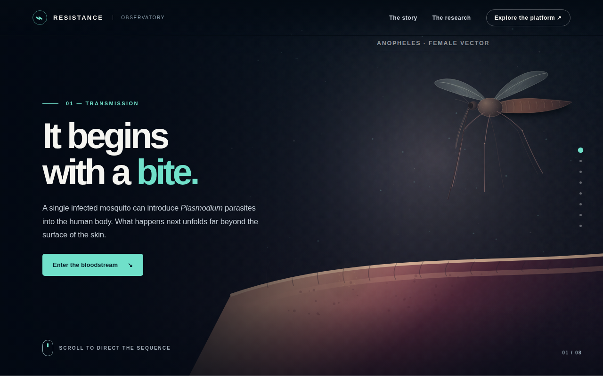
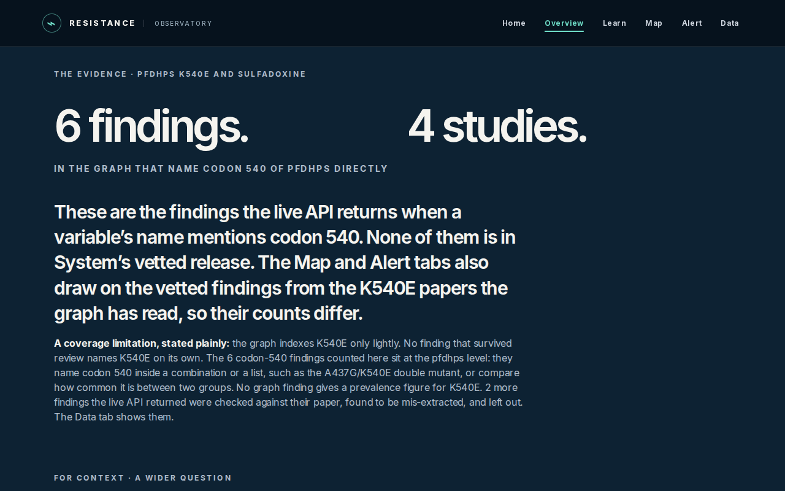
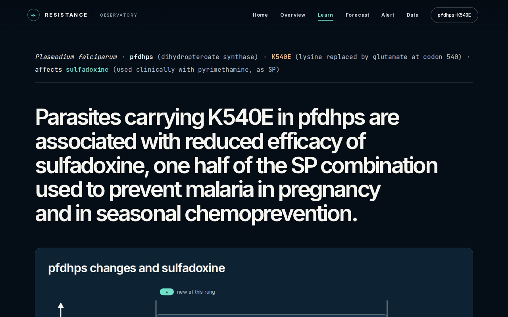
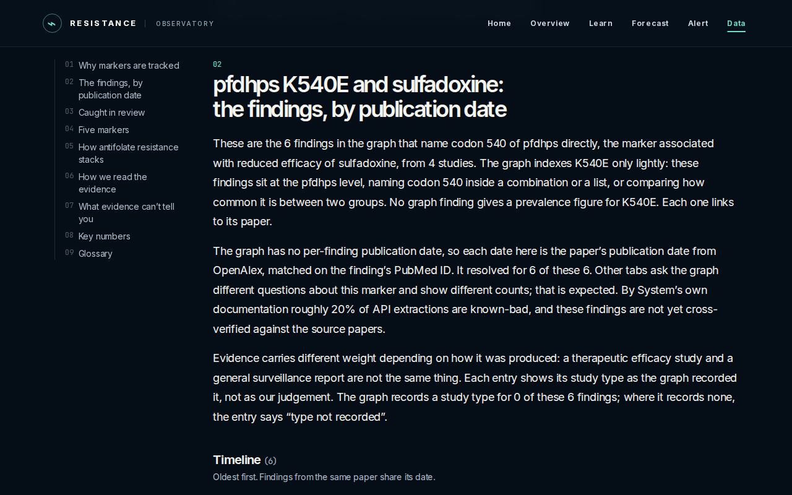

# Resistance Observatory

When does new evidence change the picture for a malaria drug-resistance marker?

A hackathon prototype (System Public Challenge, Build Challenge 3). Next.js App
Router + Tailwind, deployed on Vercel (import this repo at vercel.com/new —
framework auto-detects as Next.js; the site needs no env vars at build or run
time for Overview, Learn and Data, because their figures are pinned in
`data/graph-stats.json`).

**Honesty note.** The evidence graph is a frozen snapshot. The alert demo
replays real publication history: findings are played forward in the order
they were actually published, and the matcher reacts as if they were new. The
logic is tested on real history; the feed is a snapshot. This is not live
surveillance, not clinical guidance, and not affiliated with or endorsed by WHO.

## What this does and does not do

Scope: **one marker**, pfdhps K540E (drug: sulfadoxine, used with
pyrimethamine as SP). The evidence graph is a **July 1 2026 snapshot**.

Does:

- Replays real publication history: findings are played forward in the order
  they were actually published.
- Shows how much evidence the graph holds for the marker, with each count
  labelled by the question it answers.
- Surfaces each finding's study type, as the graph records it, and its source
  paper. (For this marker the graph records no study type, and the page says
  so for each finding.)
- Flags extractions that failed review, keeps them visible, and leaves them
  out of every count.

Does not:

- Live surveillance. Nothing published after the snapshot is in it.
- Prevalence prediction, or any forecast. The graph holds associations, not
  prevalence measurements.
- Clinical guidance. A marker association does not establish treatment
  failure for any patient.

## Screenshots

Taken from the production build of this repo.

| | |
| --- | --- |
|  `/story.html` — the landing story |  `/overview` — how much evidence the graph holds |
|  `/learn` — the marker, its drug, the ladder |  `/data` — findings by publication date |

## Tabs and owners

| Route       | What                                               | Owner    |
| ----------- | -------------------------------------------------- | -------- |
| `/`         | Redirects to `/story.html`, the animated intro     | Solayman |
| `/overview` | Scroll-driven explainer: problem, evidence, gap    | Solayman |
| `/learn`    | Marker, drug, why it matters, one diagram          | Solayman |
| `/forecast` | Map of where the marker has been observed          | Benjamin |
| `/alert`    | Save a watch; replayed evidence fires alerts       | David    |
| `/data`     | Long-form guide, findings timeline, glossary       | Solayman |

`public/story.html` is a self-contained scrollytelling intro (canvas
animation, no external assets, its own nav and styles), served outside the app
shell. Its graphics are artistic illustration, not real Public Graph records;
the page says so. Its links lead into `/learn`, `/forecast` and `/alert`.

`app/forecast/page.tsx` and `app/alert/page.tsx` are placeholders — replace
them wholesale.

## Shared selection state

```ts
import { useSelection } from "@/lib/selection";

const {
  markerId, timeRange, selectedFindingId,       // read
  setMarkerId, setTimeRange, setSelectedFindingId, setSelection, // write
  hrefWithSelection,                            // build a link that carries state
} = useSelection();
```

The URL is the source of truth: `?marker=<id>&range=<from>-<to>&finding=<id>`.
`hrefWithSelection` also passes through `&area=<ISO3>` (for example
`area=MWI`) when the current URL has one, so links to Forecast and Alert carry
both marker and area. Set or drop it with a third argument:
`hrefWithSelection("/forecast", {}, { area: "MWI" })`. The current value is
exposed as `area` from `useSelection()`.
A copied link restores the selection; the top nav carries it across tabs. No
localStorage.

## Shared components

`components/`: `Card`, `Chip`, `SectionHeading`, `EvidenceLink`, `Callout`.
Design tokens (light + dark) are CSS variables on `:root` in
`app/globals.css`, exposed to Tailwind as `bg-surface`, `text-muted`,
`text-drug`, `text-signal`, `text-gap`, etc.

`EvidenceLink` takes `systemId`, `pubmedId`, `doi` and always shows all three;
it links to doi.org first, PubMed second.

## Content

- `content/markers.ts` — typed marker content for Learn. The demo marker is
  `pfdhps-K540E` (drug: sulfadoxine, used with pyrimethamine as SP), and it is
  the only marker with written content. It is transcribed from
  `docs/MARKER-CONTENT.md`. Learn diagrams are built from the `diagram` config;
  labels are real `<text>`.
- `content/data.ts` — Data tab content, taken from `docs/SCIENCE.md`.
- Science content carries a `reviewed` flag (`content/review.ts`). Everything
  shipped is flagged `true`, and nothing is held on screen. Both source docs
  still say their claims were written from general knowledge and should be
  checked against the literature; that check has not been recorded here.
- K540E is usually reported with A437G as the double mutant. Learn says so in
  the mechanism section and on the ladder diagram, which is why other tabs can
  speak of haplotypes containing K540E and mean the same marker.

## Running it

Requires Node 22.18 or newer.

```bash
git clone https://github.com/dmsteinberger2-oss/Resistance-Observatory.git
cd Resistance-Observatory
npm install
npm run dev     # http://localhost:3000
```

Other scripts: `npm run lint` (`tsc --noEmit`), `npm run build`,
`npm run start`.

**Does the demo need a key?** Not for the story, Overview, Learn or Data. They
read pinned data and make no API calls, so `npm run dev` works straight after
`npm install` with no `.env.local`. `SYSTEM_API_KEY` is only needed to
re-pull the pinned data (below). Whether Alert and Forecast need keys of their
own (for example for Resend) is for David and Benjamin to state here.

Overview, Learn and Data run without any key: every figure they show is read from
the pinned file `data/graph-stats.json`.

To refresh that file, put your System key in `.env.local` at the repo root
(gitignored — never commit it):

```bash
echo 'SYSTEM_API_KEY=<your key>' > .env.local
echo 'OPENALEX_MAILTO=<your email>' >> .env.local   # optional: OpenAlex polite pool
node --env-file=.env.local scripts/graph-stats.ts
```

The script is server-side only. It makes about 300 requests to the System API
(the limit is 10,000 per day per key), one to OpenAlex, and streams the
~440 MB vetted associations CSV from Dataverse without saving it. To re-run
only that verification step on the pinned file, with no API key:
`VERIFY_ONLY=1 node scripts/graph-stats.ts`. It never logs or
writes the key, and the email is sent to OpenAlex only. Commit the regenerated
JSON.

## Figures

Every number in UI copy is a named constant in `lib/stats.ts`, read from
`data/graph-stats.json`, with the exact query in a comment beside it. Counts
are `GRAPH_*` (System Public Graph); publication dates are `OPENALEX_*`.
Nothing is typed in by hand, and there are no placeholder figures left.

**Each count answers one question, and is labelled with it on screen.** Other
tabs ask the graph different questions about the same marker and show
different counts. That is expected.

| Constant | Value | How it is derived |
| --- | --- | --- |
| `GRAPH_MARKER_VARIABLES` | 7 | variables that **name codon 540 directly**: hits of `GET /variables?search=name:<term>` whose name mentions codon 540 of pfdhps |
| `GRAPH_MARKER_FINDINGS` | 6 | findings that **name codon 540 directly**: associations of those variables, `GET /variables/{id}/associations`, de-duplicated |
| `GRAPH_MARKER_K540E_ALONE_FINDINGS` | 0 | of those, findings whose variable names K540E on its own, with no other codon or combination |
| `GRAPH_MARKER_STUDIES` | 4 | studies that **name codon 540 directly**: distinct `study_id` over those associations |
| `GRAPH_MARKER_TYPED_FINDINGS` | 0 | of the 6, findings whose study has a `study_type` in the graph (`GET /studies/{study_id}`); the Data timeline shows each as a chip, or "type not recorded" |
| `GRAPH_MARKER_EXCLUDED_FINDINGS` | 2 | codon-540 findings the live API returned that were checked against their paper, found mis-extracted, and excluded from every other count |
| `GRAPH_PFDHPS_FINDINGS` | 30 | findings that **cover pfdhps overall**: associations of every variable whose name identifies P. falciparum dhps (includes the 6 above) |
| `GRAPH_PFDHPS_STUDIES` | 23 | studies that **cover pfdhps overall**: distinct `study_id` over those associations |
| `OPENALEX_MARKER_DATED_FINDINGS` | 6 | codon-540 findings whose paper's publication date resolved in OpenAlex, matched on `pubmed_id` |
| `OPENALEX_MARKER_LAST_PUBLISHED` | January 21, 2023 | latest of those publication dates |
| `GRAPH_VERSION`, `GRAPH_SNAPSHOT_DATE` | 2.1, July 1, 2026 | release metadata, not an API field |
| `GRAPH_KNOWN_BAD_SHARE` | ~20% | System's API documentation, not an API field |

Coverage limitations, stated on screen as well:

- **The graph indexes K540E only lightly.** After review, no finding names
  K540E on its own. The 6 codon-540 findings sit at the pfdhps level: their
  variables name codon 540 inside a combination or a list (for example the
  A437G/K540E double mutant), or compare how common it is between two groups.
  No graph finding gives a prevalence figure for K540E. `search=name:K540E`
  returns nothing because of how names are written, so the script matches on
  name text; the selection rules are recorded in `data/graph-stats.json`
  (`marker.selection_rule`, `pfdhps_context.selection_rule`).
- **Two findings were caught in review and excluded.** `paFNq6MPX5` and
  `AeI-laBxXr` (variable "Presence of K540 E: in dihydropteroate synthase",
  PMID 25564249) were returned by the live API. Checked against the source
  abstract, their numbers belong to the A581G sextuple mutant, not K540E. They
  stay in `data/graph-stats.json` flagged `vetted: false` with a note, and are
  left out of every count and list. The Data tab shows them under "Caught in
  review".
- **The graph has no per-finding publication date.** Dates on Overview and on the
  Data-tab timeline are each paper's publication date from OpenAlex, matched
  on the finding's `pubmed_id`. All 6 resolved. A finding whose date does not
  resolve is shown as "Date unknown", outside the timeline.
- The search terms and filters are name-text matches, so a relevant variable
  with an unusual name can be missed.

## Data sources

### Primary evidence source

- **System Public Graph** — v2.1, July 1 2026 snapshot, CC BY-NC 4.0, DOI
  [10.7910/DVN/7V6JDO](https://doi.org/10.7910/DVN/7V6JDO). Queried through
  API v1.0, `https://public-api.system.com/v1/`. Every finding and every count
  on Overview, Learn and Data comes from it. Work deriving from the graph inherits
  CC BY-NC.

**Extraction errors.** System's own documentation says roughly 20% of the
associations its API serves are known-bad extractions. Every finding keeps its
`system_id`, `pubmed_id` and `doi`, and links to the paper so a reader can
check it.

### Verification layer

- **System Public Graph, vetted Dataverse release** — the same dataset DOI,
  file `system-public-graph-v1-associations.csv`. Live API results are checked
  against it: `scripts/graph-stats.ts` looks up every finding it pins by
  `system_id` and records `in_vetted_csv` on it. Alert's finding IDs are
  vetted against the same file.

What that check does and does not show for Overview and Data:

- The vetted CSV holds only associations whose two variables are both matched
  to a concept. Most findings the API returns for this marker have one
  unmatched variable, so they cannot appear in it. Of the 32 findings pinned,
  2 are in the vetted CSV (both in the wider pfdhps set).
- Two codon-540 findings were then checked by hand against the source
  abstract, found mis-extracted, and excluded (see Figures).
- The remaining 6 codon-540 findings have **not** been checked against their
  papers. One of them, `QIrkddNp_j` (PMID 16023986), has both variables
  matched to a concept and is still absent from the vetted CSV, the same
  pattern as an excluded finding. It is still shown; it should be checked
  next.

### Publication dates

- **OpenAlex** — `https://api.openalex.org`, CC0. Resolves each codon-540
  finding's `pubmed_id` to its paper's publication date
  (`scripts/graph-stats.ts`). Used for the "most recent" figure on Overview and
  the Data-tab timeline.

### Structural figure on Learn

A separate published source from the System Public Graph, loaded live in the
visitor's browser. Nothing about these structures comes from the graph.

- **RCSB Protein Data Bank** (live external source) — two crystal structures
  of *P. falciparum* HPPK-DHPS from the same publication,
  doi:10.1111/febs.15196, fetched at view time with
  `$3Dmol.download("pdb:<id>")`:
  - [6JWX](https://www.rcsb.org/structure/6JWX) — wild type.
  - [6KCL](https://www.rcsb.org/structure/6KCL) — A437G/K540E double mutant.
- **3Dmol.js** 2.4.2 — the viewer library, loaded from the cdnjs CDN by a
  `<script>` tag (not an npm dependency).

What the viewer does and does not say (`components/learn/StructureViewer.tsx`):

- Residue numbering was checked against the deposited files before anything
  was labelled. Both entries use the canonical numbering (UniProt Q25704,
  1-706). Position 540 is LYS in 6JWX and GLU in 6KCL, in both chains.
- **Position 437 has no coordinates in either structure** (it is listed among
  the missing residues, 436-444), so it cannot be highlighted or compared. The
  viewer says so on screen, and only 540 is highlighted.
- Residue names, numbers and the charge note in the compare panel are read
  from what 3Dmol reports for the loaded structures, not hard-coded.
- It makes no claim about binding geometry or mechanism.
- If the CDN or RCSB is unreachable, each panel shows a short message with a
  link to the RCSB page.

### Alert sources (David)

Taken from David's spec for the Alert tab. Items marked _to be added_ are his
to fill in.

- **MalariaGEN Pf8** — genome counts by country and collection year: 33
  countries, 1966–2022. Dataset DOI: _to be added by David_. Licence: _to be
  added_.
- **PubMed abstracts** — 372 papers on K540E. The fields Alert uses were
  **extracted by an AI model and have not been hand-checked**.
- **WHO malaria guidelines, 13 August 2025** — the source of the resistance
  bands Alert displays. Citing the guidelines is not a WHO endorsement of this
  project, and the bands are shown as published context, not as a clinical
  action rule.
- **System Public Graph, vetted Dataverse CSV** — used to vet the finding IDs
  Alert shows (see Verification layer above).
- **Resend** — email delivery service for alert emails. A service, not a data
  source; listed because the shipped app uses it.

### Forecast sources (Benjamin)

- Map data source — name, version, licence and link _to be added by
  Benjamin_. Any location on the map is attributed to that source, never to
  the System graph.

## AI coding tool disclosure

This repository was built with the help of Claude Code (Anthropic), an AI
coding assistant, under the direction of the team. This includes the app
code, the data-pull script `scripts/graph-stats.ts`, and the transcription of
the Learn content from `docs/MARKER-CONTENT.md`. Separately, the Alert tab's
PubMed abstract fields were extracted by an AI model and not hand-checked
(see Data sources). All science content is gated on human review (see `docs/SCIENCE.md`, `docs/LEARN.md`).

## Alert tab — sources, method and disclosure

The Alert tab (`/alert`) goes deep on one marker, **PfDHPS K540E**, and the
drug it bears on, sulfadoxine-pyrimethamine (SP). A researcher writes a watch
as a sentence; the tab replays every moment the evidence moved, with the
counts, the threshold and its basis, what the System graph holds, and the
email a subscriber would receive. It replays the historical record. It is not
live surveillance and not clinical guidance.

**URL convention for the other tabs:** `?marker=pfdhps-K540E&area=<ISO3>`
(the shell's existing `marker` id plus an ISO3 country). The current watch
adds `trig`, `level`, `pts`, `n`; the open alert uses the shell's `finding`
parameter. Saved, named watches live in `localStorage` in the user's browser
only; the link always holds the current watch.

### Data sources (all in `k540e-data-pack/`)

| Evidence | Source | Licence / notes |
| --- | --- | --- |
| Genome counts by country and collection year (K540E, A581G, A437G, quintuple haplotype) | MalariaGEN Pf8, <https://zenodo.org/records/18681980> (DOI 10.5281/zenodo.18681980) | CC BY 4.0. Convenience samples, dated by collection year. Wilson 95% intervals are computed in the app. |
| Triggering-study context for every genome cell (`k540e-study-context.json`, 222 country-year cells): partner study codes, Admin-1 sites, DNA preparation (gDNA / sWGA / MDA), % callable genome, mixed-genotype and K540N calls, ENA run accessions | MalariaGEN Pf8 sample metadata and marker genotypes, <https://zenodo.org/records/18681980> | CC BY 4.0. Sites are attributed to MalariaGEN, never to the System graph. A unit test checks all 222 cells against the genome counts. |
| 372 papers mentioning K540E, with abstract figures, association sentences and first-report claims | PubMed (NCBI E-utilities), searched 14 November 2026 | Abstract items were read by a language model; a program kept only quotes that appear word for word in the abstract. Not checked by hand, so every one is shown as a quote with its PubMed link. |
| Graph findings, concept ids, vetted association ids; live queries | System Public Graph, <https://doi.org/10.7910/DVN/7V6JDO>; API <https://public-api.system.com> | Non-commercial. Work deriving from the graph is CC BY-NC. |
| Marker status, SP-resistance categories, history | WHO guidelines for malaria, 13 August 2025, <https://iris.who.int/server/api/core/bitstreams/26a6af2d-060c-4449-8207-1f25e63c6cc3/content> (categories: PDF page 105; continuing IPTp-SP: PDF pages 104 and 107–108); WHO Compendium of molecular markers for antimalarial drug resistance, <https://www.who.int/publications/m/item/compendium-of-molecular-markers-for-antimalarial-drug-resistance>; other WHO documents linked inside `k540e-thresholds.json` | Quoted verbatim with page references. Presets outside East and Southern Africa are this project's, and are labelled as presets. |

Citation: System, Inc. (2026). *System Public Graph* (Version 2.1) [Data set].
DOI: <https://doi.org/10.7910/DVN/7V6JDO>

### How the graph is used, and what was verified

- The graph has read 10 of the 372 K540E papers, and no graph finding names
  K540E on its own. The tab shows that gap, what the graph did extract from
  those 10 papers, and the unread papers for the selected country as a
  ready-to-ingest PubMed id queue.
- About a fifth of associations returned by the API are known-bad
  extractions. `/api/alert/system` returns only associations whose id is in
  the vetted list (4,912 ids, from the Dataverse CSV snapshot of 8 July 2026)
  and counts the rest as quarantined; they are never displayed.
- Seven graph findings were compared against their paper
  (`source_checked: true` in the pack) and are labelled "Source-checked
  against paper". Every other graph finding is labelled "Reported by System
  Graph, unverified".
- Alert sentences are templates filled from the data. No language model runs
  in the app.
- Early-warning alerts fire on thin signals too. Nothing is suppressed;
  instead every alert carries the study behind it, in the inspector, the
  Decision Receipt, the feed cards, the timeline hovers and both email
  formats: partner study codes, single-site and subnational-clustering flags,
  DNA preparation and genome callability with ENA links to the raw reads,
  mixed-genotype and alternative codon-540 (K540N) calls, the local prior
  (genome cells for the same country collected earlier), and the cutoff shown
  beside the observed proportion with its Wilson interval. The "next steps"
  lines are surveillance follow-up a reviewer would look for (verification,
  wider sampling, WHO therapeutic / chemoprevention efficacy studies). They
  are not clinical guidance and not a WHO instruction.
- The three lanes are badged as different kinds of study: "Curated WGS
  Surveillance (MalariaGEN Pf8)", "Published Molecular / Clinical Paper"
  (with site, population and any assay word in the title) and System Graph
  findings (with `study_type` and `population` beside the statistic).
- The email subject leads with evidence source, study scope and assay, e.g.
  `[MalariaGEN Pf8 WGS · 1 study, single-site Kilifi (sWGA/gDNA)] Kenya K540E (SP marker) 78.6% (44/56) — WHO 60% line; confirm via TES/CES`.

### Running and testing

```bash
node --test lib/alert/*.test.mts   # derivation + the data pack's check figures (Node 24, no test library)
npx tsc --noEmit
npx next build
```

Optional server-side environment variables: a System API key
(`SYSTEM_API_KEY`) for live graph calls, and `RESEND_API_KEY` (plus optional
`ALERT_FROM_EMAIL`) to send alert emails. Without them the tab shows the
snapshot and the email control reads "Preview only".

### AI-assistance disclosure (Alert tab)

The Alert tab's code was written with AI assistance (Claude Code, Anthropic)
under the direction of the team. The data pack was also prepared with AI
assistance from the public sources above, including the machine-read,
quote-verified abstract items, which no human has checked.

### Forecast map contract

`data/alerts.json` lists the Alert tab's default alerts for every country
(each region's default rule on the genome counts; cells of at least 20
samples, except first detections, which are badged weak when thin). Each item
is `{ id, marker_id, country_iso3, year, rule, headline }`.
`getDefaultMapAlerts()` in `lib/alert/mapAlerts.ts` returns the same list.
Regenerate with `node lib/alert/generate-map-alerts.mts` (a test fails if the
file drifts from the pack). Link an alert to its inspector with
`/alert?alert=<id>`; the Alert tab links back with
`/forecast?country=<ISO3>&marker=pfdhps-K540E`.
